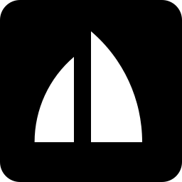
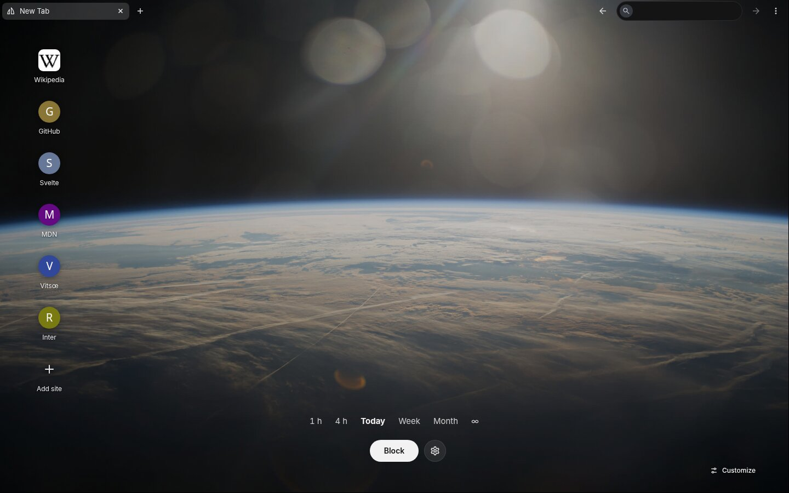

<div align="center">



# Mast

A deep-work browser. One button blocks every known distraction for a set time,<br>
and nothing inside the browser can stop it early.

[](LICENSE)
[](browser/chromium_version.txt)
[](#install)

[Install](#install) · [What it does](#what-it-does) · [Build](#build) · [Licence](#licence)



</div>

## Install

```sh
curl -fsSL https://github.com/mast-browser/mast/releases/latest/download/install.sh | sh
```

64-bit Linux. On Debian, Ubuntu, Fedora and openSUSE, updates then come with the system's own.

## What it does

- **Block**: pick a length of time and every distraction category closes until it's over.
- **YouTube your way**: allow it, block Shorts, allow music only, or block it all.
- **Your own categories**: add sites to Mast's lists, or make lists of your own.
- **No Google by default**: built on [ungoogled-chromium](https://github.com/ungoogled-software/ungoogled-chromium); Chrome extensions still work.

## Build

The browser is built on a rented server from `browser/` (see [`browser/docs/RELEASING.md`](browser/docs/RELEASING.md)).
`demo/` is the design prototype.

## Licence

[GPL-3.0](LICENSE). Mast builds on Chromium and ungoogled-chromium, whose code keeps its
BSD-style notices. The pictures are NASA's ([credits](browser/wallpapers/CREDITS.md)).
